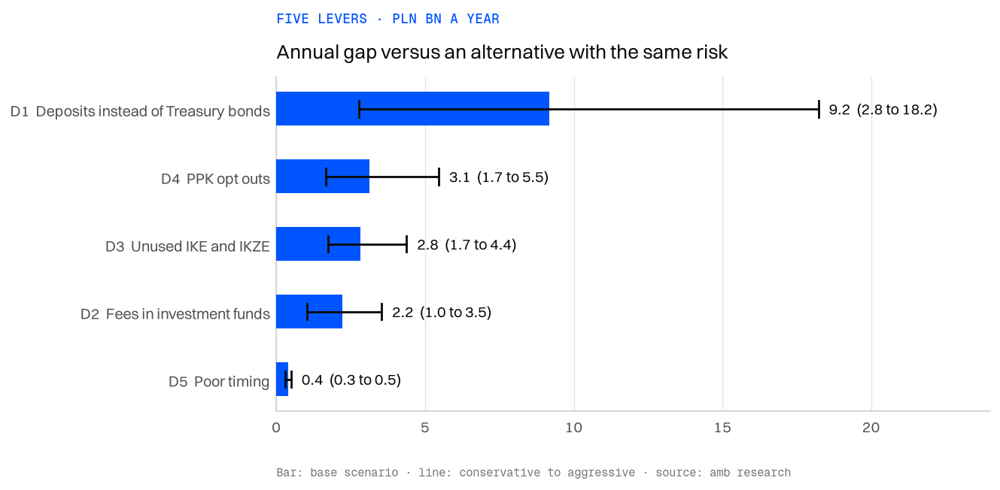
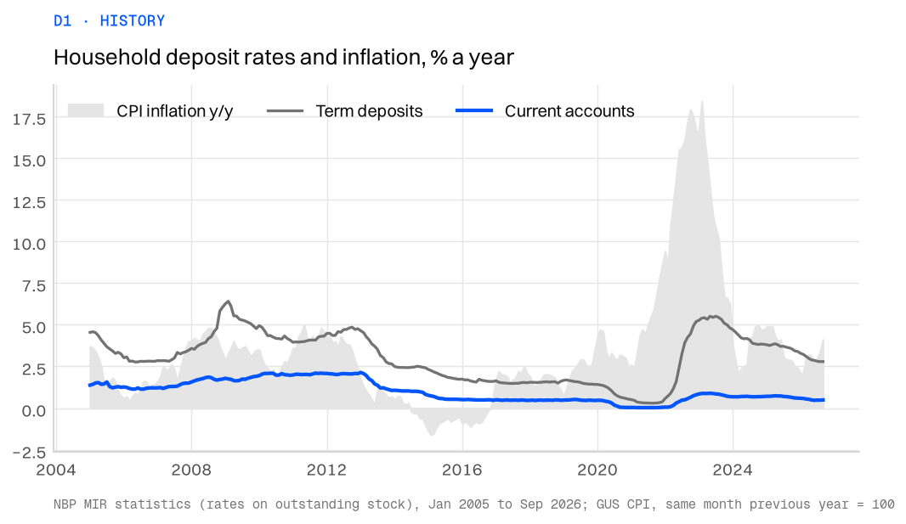
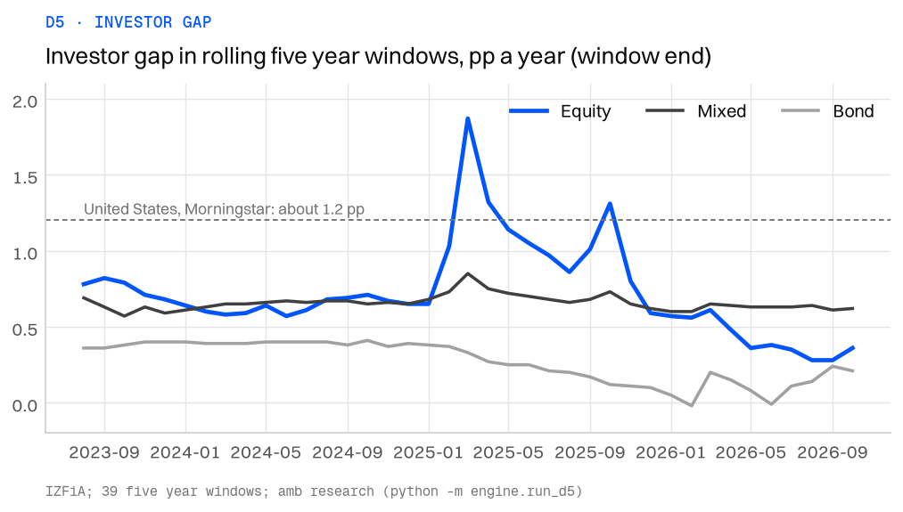

<p align="center">
  <picture>
    <source media="(prefers-color-scheme: dark)" srcset="report/assets/logo_white.png">
    
  </picture>
</p>

<h1 align="center">amb research · Report 01</h1>

<p align="center"><b>Money left on the table</b><br>
How much Polish households lose every year through the way they save, measured against alternatives of equal risk.</p>

<p align="center">
  <a href="report/pdf/amb_research_report_01.pdf">Report (PDF, 28 pages)</a> ·
  <a href="report/deck/amb_research_report_01.pptx">Deck (PPTX, 56 slides)</a> ·
  <a href="#reproduce-every-figure">Reproduce</a> ·
  <a href="https://amb.watch">amb.watch</a>
</p>

---

## The finding

Polish households forgo about **PLN 17.8 bn a year** (range PLN 7.5 bn to 32.1 bn), roughly 0.5% of GDP and twice the entire Belka tax take. More than half of it comes from money that simply sits idle. Poor market timing, the culprit most people would name first, turns out to be the smallest lever of all.

| Lever | What is measured | Conservative | Base | Aggressive |
|:--|:--|--:|--:|--:|
| **D1** | Deposits instead of Treasury bonds | 2.8 | **9.2** | 18.2 |
| **D4** | PPK opt outs | 1.7 | **3.1** | 5.5 |
| **D3** | Unused IKE and IKZE tax wrappers | 1.7 | **2.8** | 4.4 |
| **D2** | Fees in investment funds | 1.0 | **2.2** | 3.5 |
| **D5** | Poor timing of fund purchases and sales | 0.3 | **0.4** | 0.5 |
| | **Total, PLN bn a year** | **7.5** | **17.8** | **32.1** |

<p align="center"></p>

### Six findings

1. **Idle money costs the most.** About PLN 1.1 trn sits in current accounts paying an average of 0.49%. Since 2005, current accounts have beaten inflation in only 22.6% of months; term deposits in 56.3%.
2. **Free public programmes go unused.** About 2.8 mn eligible employees are outside PPK, forgoing employer contributions and state subsidies that carry no market risk.
3. **Tax shelters are legal, free and ignored.** About 1.3 mn IKE accounts exist for more than 30 mn adults, although early withdrawal costs no more than the ordinary tax.
4. **Outside equity, cheap index funds barely exist.** They hold 0% to 2% of bond and mixed fund assets, against 10.1% in equity funds.
5. **Polish investors time the market better than expected.** The investor gap is typically 0.4 to 0.7 pp a year, below the roughly 1.2 pp measured in the United States.
6. **The popular headline is about five times too high.** Media estimates of PLN 50 bn compare entire balances with inflation; counting only movable money against a bond of equal risk, after tax, gives PLN 9.2 bn.

---

## Method

The report rests on one principle: **like for like risk**. Every loss is the difference between what money earns today and what it would earn in an alternative that is at least as safe, available to the same saver, after the same taxes. Inflation alone is never the benchmark.

Each lever is modelled under three explicit scenarios. Every assumption sits in a named constant in the code, carries a source, and moves the result in a way that the tornado charts in the report make visible.

<table>
<tr>
<td width="50%" valign="top">

**D1 · Deposits versus COI bonds**<br>
Movable shares of current accounts and term deposits, compared with four year inflation indexed Treasury bonds (4.75% in year one, then CPI plus 1.5 pp). The 19% Belka tax applies on both sides; early redemption costs are included.

</td>
<td width="50%" valign="top">

**D2 · Fee drag**<br>
Ongoing charges of active funds against the cheapest alternative of the same asset class, per category and scenario. Short term bond fund costs come from KID documents for 12 funds holding 68.6% of the category.

</td>
</tr>
<tr>
<td valign="top">

**D3 · IKE and IKZE**<br>
The share of the PLN 9 bn annual Belka tax take that savers could legally shelter within current contribution limits, measured from the tax paid today to avoid double counting with D1.

</td>
<td valign="top">

**D4 · PPK opt outs**<br>
The employer contribution of 1.5% net of 12% PIT, plus the PLN 240 annual state subsidy, multiplied by the number of eligible employees outside the programme.

</td>
</tr>
<tr>
<td colspan="2" valign="top">

**D5 · Investor gap**<br>
Time weighted fund returns (TWR) against money weighted investor returns (IRR), computed monthly from IZFiA net flows and assets with a modified Dietz method. A reclassification alignment stops funds that switch category from registering phantom gains or losses. The headline is the median of 39 rolling five year windows, because the full period result depends heavily on its end points.

</td>
</tr>
</table>

<p align="center">
  
  
</p>

---

## Data

| Source | Used for | Access |
|:--|:--|:--|
| **IZFiA** | Monthly net flows and assets of every Polish investment fund, Aug 2018 to Oct 2026 | Downloaded and parsed by the engine |
| **NBP** | MIR interest rate statistics on household deposits | Downloaded by the engine |
| **GUS** | Monthly consumer price index since 1982 | Downloaded by the engine |
| **Ministry of Finance** | Belka tax receipts, 2024 to 2026F | As reported by PAP and analizy.pl |
| **PFR** | PPK participation by sector | Published statistics |
| **KNF** | Financial situation of fund managers in 2025 | Annual report |
| **KID documents** | Ongoing charges of short term bond funds | `data/reference/short_term_fund_costs.csv` |
| **obligacjeskarbowe.pl** | COI bond offer, November 2026 | Published terms |

Every download is logged with its URL, date and SHA 256 checksum in `data/raw/*/_manifest.csv`. Raw files are not committed; the processed panels in `data/processed/` are, so every figure can be rebuilt without network access.

---

## Reproduce every figure

**Requirements:** Python 3.11 or newer, Node.js 18 or newer, and Google Chrome or Chromium for the PDF.

```bash
python -m venv .venv && source .venv/bin/activate
pip install -e ".[dev]"
```

Run the full engine from the committed processed data. This prints the report to the terminal, recomputes all five levers, writes `report/data.json` and renders 16 charts:

```bash
python -m engine.report
```

Each lever also runs on its own and writes a CSV to `data/processed/`:

```bash
python -m engine.run_d1
```

To rebuild from the original sources, download the raw files first, then rebuild the IZFiA panel:

```bash
python -m engine.data.public
```

```bash
python -m engine.data.izfia
```

```bash
python -m engine.run_d5 --fresh
```

Build the PDF report and the slide deck:

```bash
python report/pdf/build_pdf.py
```

```bash
cd report/deck && npm install && node build_deck.js
```

Run the test suite (29 tests covering the investor gap mathematics and every model):

```bash
pytest
```

### Fonts

The visual identity follows amb.watch: **Switzer** for text and **Geist Mono** for labels. Geist Mono is included under the SIL Open Font License. Switzer is free but may not be redistributed, so download it from [Fontshare](https://www.fontshare.com/fonts/switzer) and place the `.otf` files in `report/fonts/`. Without it, charts and the PDF fall back to a neutral sans serif.

---

## Repository

```
engine/
  data/            downloaders and the IZFiA parser (three file formats, stable fund categories)
  models/          deposits, fee_drag, tax_wrappers, ppk, investor_gap
  run_d1 … run_d5  one command per lever, each writing a CSV
  report.py        the whole pipeline in one command
  ui.py            terminal output in the amb research style
  charts.py        16 charts in SVG and PNG
data/
  processed/       engine outputs and cached IZFiA panels
  reference/       hand collected reference data with sources
report/
  pdf/             long form report and its HTML to PDF builder
  deck/            56 slide deck and its pptxgenjs builder
  charts/          every chart used in the report
  assets/          logos
tests/             unit tests
```

---

## Limitations

This is draft 0.2. The most important open points, each with the way version 1.0 will address it:

| Limitation | Effect on the result | Next step |
|:--|:--|:--|
| The movable share of current accounts (D1) is an assumption | ±PLN 3.6 bn around the base case | NBP wealth survey and a survey question |
| The avoidable share of Belka tax (D3) is an assumption | PLN 1.7 bn to 4.4 bn | Distribution of savings by portfolio size |
| Wages of PPK opt outs (D4) are estimated | PLN 2.6 bn to 3.8 bn | PFR data on participant structure |
| D2 assumes active funds earn zero alpha before fees | May overstate D2 | Net returns against benchmarks |
| D5 is measured at category level | Understates D5 | Flows for individual funds |
| Several figures come from press reports | Risk of an outdated figure | Source files obtained directly |

The full methodology and every limitation are discussed in chapter 12 of the PDF.

---

<p align="center">
  <sub>amb research is the research arm of <a href="https://amb.watch">amb.watch</a>. Recommendations concern product categories, not individual products. Nothing in this repository is investment advice.</sub>
</p>
